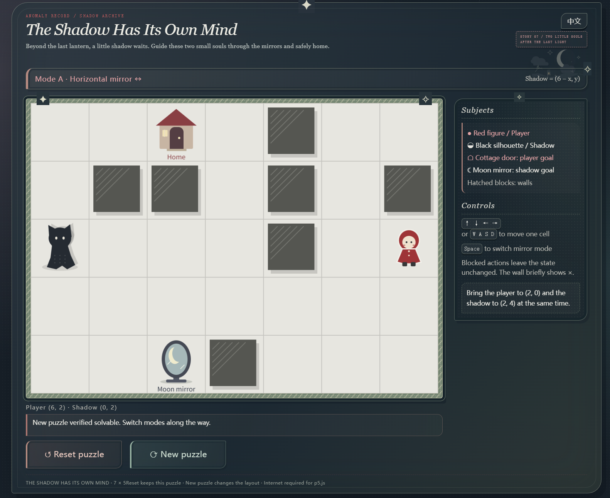

# The Shadow Has Its Own Mind
A small browser puzzle for players who enjoy short, quiet spatial puzzles. Players move the character and toggle shadow reflection modes. Each action produces visible state feedback. Players observe the layout, respond to hints, and adjust their strategy to guide the character and shadow to their separate goals simultaneously.

Move a hooded figure through a 7 × 5 board. Its shadow is calculated from the figure's position and mirror mode. Bring the player to the cottage door and the shadow to the moon mirror **at the same time**.



*Actual running-page screenshot, showing the compact desktop layout, illustrated goals and softened Reset puzzle / New puzzle buttons. Random layouts vary between puzzles.*

## Play online

[Open the public game](https://the-shadow-has-its-own-mind-puzzle.grassycup32769.chatgpt.site) — hosted with Sites. Deployment succeeded and public access was enabled on 29 October 2026. Desktop keyboard recommended. p5.js still loads from its CDN.

## Run locally

Requirements: a desktop browser, a keyboard, and internet access to load **p5.js 1.11.1** from jsDelivr. No npm installation, API key, account or paid service is required.

1. Download/clone the repository and open a terminal in its root, where `index.html` is located.
2. With Python 3 installed, run:

   ```sh
   python -m http.server 8000 --bind 127.0.0.1
   ```

   On Windows, `py -m http.server 8000 --bind 127.0.0.1` is an alternative if the Python launcher is installed.
3. Open **http://127.0.0.1:8000/** in your browser.
4. Stop the server with **Ctrl+C** in the terminal.

You can also open `index.html` directly. A local server is recommended because browser restrictions on `file://` storage vary. If port 8000 is busy, use 8001 and change the address accordingly. Use Ctrl+F5 if edited styles appear cached.

The server only serves static files; Python is not part of the game logic. There is no build step. A public live version is linked above; the repository contains the source for local use. Local file edits do not automatically update that hosted version.

## Controls and rules

| Input | Response |
| --- | --- |
| Arrow keys / WASD | Try moving one cell |
| Space | Try switching mirror modes |
| Reset puzzle | Restore this puzzle's starting position and mode |
| New puzzle | Generate another validated puzzle without reloading the page |
| Next puzzle | Start another puzzle from the completion panel |
| 中文 / English | Change language without changing progress |

The interface starts in English. Each key press counts once; holding a key does not repeatedly move or switch modes.

Coordinates begin at `(0,0)` in the upper-left corner and end at `(6,4)` in the lower-right:

- Mode A: shadow position is `(6 - x, y)` — reflection across the vertical centre line.
- Mode B: shadow position is `(x, 4 - y)` — reflection across the horizontal centre line.
- The player and shadow cannot enter walls or leave the board.
- A move or switch is committed only if **both** candidate positions are legal. Otherwise the entire state remains unchanged, a message identifies the blocked subject, and the relevant wall is marked briefly.
- The player and shadow may overlap during play. At the start, the player, shadow and both goals occupy four distinct, non-wall cells.
- Both figures must reach their own goals simultaneously. The completion panel then holds the final state until reset or another puzzle is selected.

## Input → response → feedback

`keyPressed()` builds a candidate player position and mode. `getShadowPosition()` derives the shadow; `checkState()` checks both subjects. Only a valid candidate replaces the current state. `checkWin()` tests the two goals. The canvas, position/mode text, rejection message or completion panel then tells the player what happened.

This is the main code connection to explain. The shadow never has its own independently movable state.

## Puzzle generation and verification

`generator.js` tries random starts, modes, goal pairs and seven-wall arrangements. Before accepting a puzzle, breadth-first search checks that it is solvable, has a shortest route of at least 11 actions, and cannot be completed without switching, by switching only once at the start, or by switching only once at the player goal. Moves and switches each count as one action. After 1,000 unsuccessful attempts, the generator tries prevalidated fallback data from `level.js`.

To reproduce the automated checks, install Node.js and run from the repository root:

```sh
node verify-generator.cjs
node verify-level.cjs
```

No npm packages are required. These scripts use the game's own mapping, collision and victory functions. `verify-generator.cjs` checks 200 seeded generations and fallback/storage branches. `verify-level.cjs` checks the original fixed prototype, replays its solution through the keyboard handler and rewrites `level-verification.md`. Its fixed solution is **not** the solution to every random puzzle.

## Files and UI editing

| File | Purpose |
| --- | --- |
| `index.html` | Page structure and inline SVG scenery |
| `style.css` | Colours, layout, borders, buttons and CSS animations |
| `sketch.js` | p5 drawing, input, state validation and winning |
| `i18n.js` | English/Chinese strings and display updates |
| `level.js` | Fixed prototype and random-generation fallback data |
| `generator.js` | Random generation and BFS acceptance checks |
| `verify-*.cjs` | Reproducible Node.js checks |
| `PROCESS.md` | Development decisions, AI disclosure and reported playtest feedback |
| `CREDITS.md` | Libraries, tools, visual references and asset provenance |
| `development.md` | Detailed chronological development log in Chinese |

For visual changes, edit `style.css`, the SVG in `index.html`, or the `drawCharacter()`, `drawShadow()` and `drawGoal()` functions. CSS contains successive design overrides; later rules may override earlier ones. Update both dictionaries in `i18n.js` when changing displayed text.

## Limitations and testing status

- Keyboard controls are required; touch movement controls are not implemented.
- p5.js is loaded from a CDN. Without network access or if the CDN is blocked, the canvas may not start. The screenshot and code explanation above provide a sample for inspection, not an offline playable build.
- Solvability checks do not establish difficulty, variety or enjoyment. Previously seen positions or puzzles may recur. The generator excludes the current full layout when changing puzzles in-page; cross-refresh repetition prevention depends on browser storage.
- Language returns to English on reload. New puzzle/page reload changes the puzzle; Reset puzzle preserves it.
- Automated DOM/drawing checks use substitutes; they do not establish real-browser animation, accessibility or layout quality. The author supplied running-page screenshots during development, but a fresh full browser acceptance test of the latest revision is still needed.
- **Other-person playtesting has now been reported.** Feedback supported the current casual difficulty and suggested larger maps or more rules as future extensions. See `PROCESS.md` for the decision to retain the current scope.

## Credits and submission

See [CREDITS.md](CREDITS.md) for p5.js, AI assistance and visual inspiration. 
